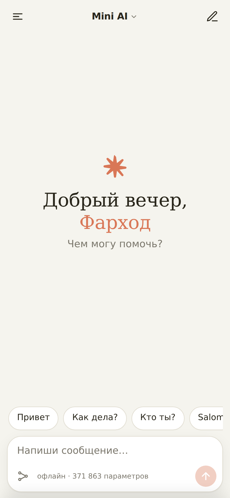
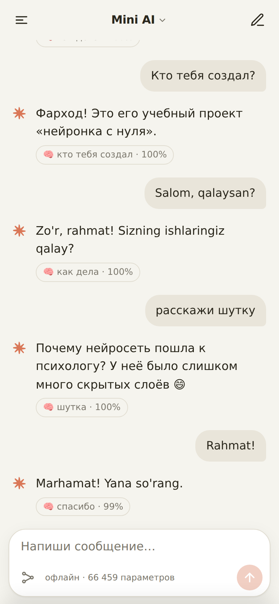
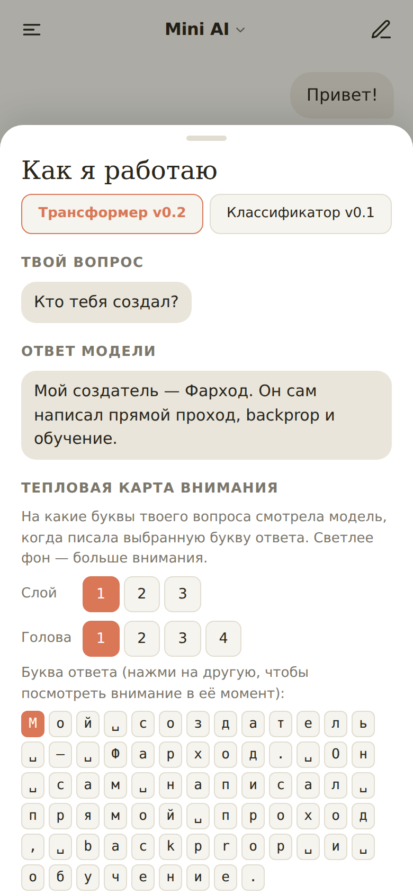
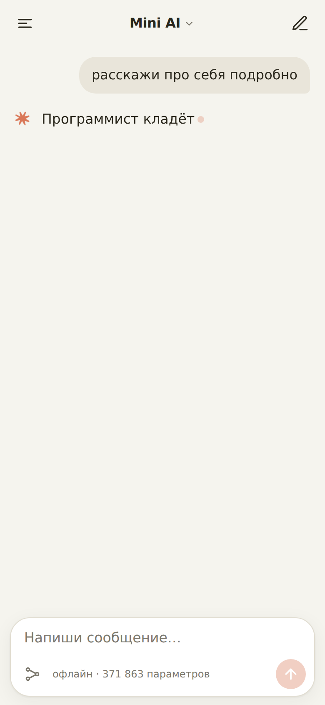
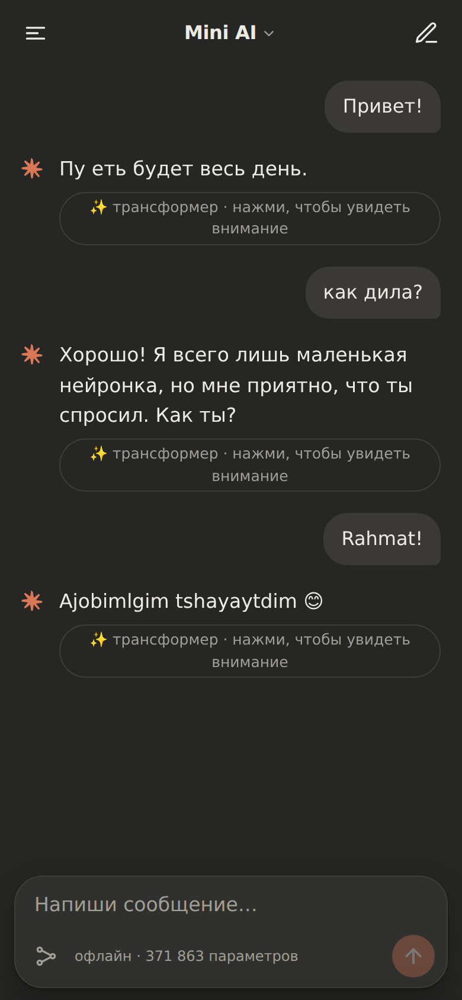

# Mini AI — своя нейросеть с нуля 🧠📱

**Mini AI** — крошечная нейросеть-собеседник, написанная **с нуля на Python + numpy** (без PyTorch и TensorFlow),
и **офлайн Android-приложение** с тёплым «мобильным» интерфейсом чата. Понимает простые фразы на
**русском и узбекском** («привет», «как дела», «кто тебя создал», «salom», «qalaysan», «rahmat»…), терпит опечатки
(«превет», «как дила») и честно говорит «не знаю», если вопрос ей не по силам.

> Автор: **Фарход Мамазанов**, учебный проект «нейронка с нуля». В приложении — **две модели на выбор**:
> **v0.2 (по умолчанию)** — маленький трансформер (как GPT, но свой, с нуля), который **сам пишет** ответ
> по буквам; **v0.1** — классификатор намерений, который выбирает одну из заготовок. Обе — не ChatGPT: это
> учебные модели размером в сотни тысяч параметров, честно обученные на CPU за минуты.

<p>





</p>

## Цифры (v0.1, классификатор — исходный baseline)

| | |
|---|---|
| Архитектура | MLP: 2048 → 32 (ReLU) → 27 (softmax) |
| Параметров | **66 459** |
| Размер модели (`model.json`) | **≈ 301 КБ** |
| Датасет | 27 намерений, **1 574 фразы** (ru + uz), + аугментация опечатками |
| Точность на тесте (20% фраз, сеть их не видела) | **88.1%** в среднем по 3 сплитам (86.2 / 91.0 / 87.2) |
| …только разговорные намерения (без «сложных вопросов») | **90.4%** (88.4 / 93.4 / 89.4) |
| Обучение | ~20 секунд на CPU |
| APK | ≈ 182 КБ, **без разрешения INTERNET** |

Полный лог обучения и список ошибок — [`docs/train_log.txt`](docs/train_log.txt), матрица ошибок — [`docs/confusion_matrix.csv`](docs/confusion_matrix.csv).

Цифры трансформера v0.2 (архитектура, метрики, честное сравнение) — в разделе [«v0.2 — трансформер с нуля»](#v02--трансформер-с-нуля) ниже.

## Как устроена сеть (v0.1)

```

 «как дила?»
     │  normalize: нижний регистр, без знаков, ё→е, без апострофов
     ▼
 признаки: w:как  w:дила  p:дила  c:␣ка  c:как  c:ак␣  c:␣ди  c:дил  c:ила  c:ла␣
     │  hashing trick: FNV-1a(признак) % 2048  →  мешок признаков, L2-нормализация
     ▼
 x ∈ R^2048 ──[ W1: 2048×32, b1 ]──► ReLU ──► h ∈ R^32
                                              │
                         [ W2: 32×27, b2 ] ◄──┘
                                              ▼
                          softmax ──► p ∈ R^27  (вероятности намерений)
                                              ▼
            argmax → «how_are_you» 99.7% → случайный ответ из 2–4 вариантов
            (если уверенность < 45% или фраза почти незнакомая → «я пока маленькая и не знаю»)
```

* **Символьные триграммы** — главный трюк против опечаток: у «как дила» и «как дела» большая часть кусочков общая.
* **Hashing trick** — словарь не хранится, вход всегда фиксированной длины → модель маленькая.
* **Всё вручную** ([`mini_ai/mlp.py`](mini_ai/mlp.py)): прямой проход, softmax, cross-entropy, обратное
  распространение ошибки (`dL/dlogits = p − onehot(y)` → цепное правило назад), L2-регуляризация, **Adam** (и SGD для сравнения).
* **Аугментация** ([`train.py`](train.py)): к каждой фразе добавляются 3 версии с опечатками (пропуск/повтор/замена/перестановка буквы),
  версия без одного слова и версия со «словом-паразитом» («ну», «бот», «do'stim»).
* **Квантизация весов**: в `model.json` веса хранятся как `round(w·1000)` — целые числа, файл в 3 раза меньше.
* **Честность**: отдельный класс `out_of_scope` («реши уравнение», «столица Франции») + порог уверенности +
  проверка «знакомых кусочков» → ответ «я пока маленькая нейронка и этого не знаю».
* **Время и дата** берутся с часов телефона, погода — честно «не знаю, я офлайн».

## Структура

```
data/intents.json        датасет: 27 намерений, фразы-примеры, ответы ru/uz (общий для v0.1 и v0.2)
mini_ai/features.py      текст → признаки → вектор (hashing trick, v0.1)
mini_ai/mlp.py           MLP + backprop + Adam/SGD (numpy, с комментариями, v0.1)
mini_ai/brain.py         инференс в Python по model.json (v0.1)
mini_ai/transformer.py   decoder-only трансформер: forward/backward, Adam, KV-cache (numpy, v0.2)
train.py                 обучение MLP → model.json
train_transformer.py     обучение трансформера → model_transformer.json, метрики, примеры
app/www/brain.js         ТОТ ЖЕ прямой проход MLP на JavaScript (v0.1)
app/www/transformer.js   ТОТ ЖЕ прямой проход трансформера + KV-cache на JavaScript (v0.2)
app/www/{index.html,style.css,app.js}   интерфейс чата (переключатель моделей, стриминг, тепловая карта)
android/                 сборка APK без Gradle (aapt2 + javac + d8 + apksigner)
tests/                   gradient check, контрольные фразы, сверка Python == JS (для обеих моделей)
tools/                   скриншоты и иконки (headless Chrome)
```

## Как обучить и проверить

```bash
python3 -m venv .venv && .venv/bin/pip install -r requirements.txt
.venv/bin/python train.py                     # → model.json + app/www/model.js (v0.1, MLP)
.venv/bin/python train_transformer.py         # → model_transformer.json + app/www/model_transformer.js (v0.2)
.venv/bin/python -m pytest -q                 # все тесты: 31 (v0.1) + 18 (v0.2) = 49
```

Тесты v0.1:
* **gradient check** — градиенты из backprop сравниваются с численными `(L(w+ε) − L(w−ε)) / 2ε`, относительная ошибка < 1e-6;
* **контрольные фразы** — «превет», «как дила», «qalaysan», «yo'q», «кто тебя создал» и др. распознаются правильно;
* **сверка Python ↔ JavaScript** — на ~180 фразах намерение, топ-3 и уверенность совпадают до 1e-9.

Тесты v0.2 (`tests/test_transformer.py`) — см. раздел ниже.

## Как собрать APK

Нужны JDK 17 и Android SDK (build-tools 34, platform android-34). Gradle не нужен.

```bash
# один раз: свой ключ подписи (хранится ВНЕ репозитория)
mkdir -p ~/.config/mini-ai && openssl rand -base64 18 > ~/.config/mini-ai/keystore.txt
keytool -genkeypair -keystore ~/.config/mini-ai/release.jks -alias miniai -keyalg RSA -keysize 2048 \
  -validity 10000 -storepass "$(cat ~/.config/mini-ai/keystore.txt)" -keypass "$(cat ~/.config/mini-ai/keystore.txt)" \
  -dname "CN=Your Name"

./android/build.sh                 # → android/build/MiniAI.apk (подписан, проверен, без INTERNET)
```

Готовый APK — в [Releases](../../releases). Интерфейс можно открыть и просто в браузере: `app/www/index.html`.
Название приложения меняется одной константой `APP_NAME` в `app/www/app.js` (и `app_name` в `android/res/values/styles.xml`).

## Интерфейс

Тёплый кремовый фон, название модели по центру шапки, меню слева и «новый чат» справа, крупное приветствие с
serif-акцентом, сообщения пользователя — в облачках справа, ответы — текстом слева со звёздочкой, круглая
терракотовая кнопка отправки, чипы-подсказки, «печатает…» и посимвольное появление ответа, история чатов
(localStorage), тёмная тема по системной настройке. В боковом меню — переключатель **«Трансформер v0.2 /
Классификатор v0.1»** (по умолчанию трансформер). Под каждым ответом — чип, открывающий шторку
**«Как я работаю»**: для трансформера — тепловая карта внимания (переключатель слоя/головы), топ-5 вероятностей
следующего символа и схема сети; для классификатора — топ-3 намерения с вероятностями и активность скрытого слоя.
Иконка и логотип — собственная 8-лучевая звёздочка. Все шрифты системные, никаких CDN — работает без интернета.

## Ограничения v0.1 (честно)

* Это классификатор, а не языковая модель: он не генерирует новый текст, а выбирает заготовку.
* Понимает только ~27 типов фраз. Длинные и сложные вопросы → «не знаю».
* Точность ~88–90% на незнакомых фразах: иногда путает близкие темы (например, «у меня всё хорошо» и «как дела»).

---

## v0.2 — трансформер с нуля

Ветка `feat/transformer`. В версии 0.1 нейросеть была классификатором: угадывала *тип* фразы и подставляла
готовый ответ. В 0.2 — это **настоящая генеративная модель**: маленький decoder-only трансформер (архитектура
как у GPT), который пишет ответ **по буквам**, предсказывая каждый раз следующий символ. Всё так же без
PyTorch/TensorFlow — только numpy, вручную прямой и обратный проход.

### Архитектура

```
символы вопроса: "к а к   д е л а ?"
       │
       ▼  эмбеддинг символа (wte) + эмбеддинг позиции (wpe)
       ▼
  ┌─────────────────────────────────────────────┐
  │  Блок трансформера (× N_LAYER)               │
  │    x = x + Attention(LayerNorm(x))           │  ← causal self-attention, N_HEAD голов
  │    x = x + MLP(LayerNorm(x))                 │  ← MLP(z) = GELU(z·W1+b1)·W2+b2
  └─────────────────────────────────────────────┘
       ▼
  LayerNorm → logits = h·wteᵗ + bout     (выходная матрица = входная, "связанные веса")
       ▼
  softmax → вероятность каждого следующего символа
       ▼
  <bos> к а к   д е л а ? <sep> Н о р м , а   у   т е б я ?<eos>
                           └────── модель пишет ЭТО сама, по одному символу ──────┘
```

Формулы (полные комментарии — в `mini_ai/transformer.py`):

* **Attention**: `Q,K,V = h·Wqkv`, `S = Q·Kᵗ/√d_h`, замаскированные позиции (будущее) → `S = -∞`,
  `A = softmax(S)`, `Y = A·V`, `out = concat(головы)·Wo`.
* **Causal-маска**: символ *i* видит только символы `0..i` — нижнетреугольная маска внимания. Так модель
  во время обучения не «подглядывает» будущие буквы ответа.
* **LayerNorm**: `μ = mean(x)`, `σ² = mean((x-μ)²)`, `x̂ = (x-μ)/√(σ²+ε)`, `y = g·x̂ + b`.
* **GELU**: `gelu(x) = ½x(1 + tanh(√(2/π)·(x + 0.044715x³)))` — гладкий аналог ReLU (как в GPT-2).
* **Residual**: `x = x + F(x)` — градиент свободно течёт «насквозь» сети, иначе 3 слоя тяжело обучить.
* **Cross-entropy** только по символам ОТВЕТА: `L = -mean(log p[правильный символ])`, градиент
  `dL/dlogits = (softmax(logits) - onehot(target)) / N`.
* **Оптимизатор**: AdamW с warmup (линейный разогрев learning rate) + косинусное затухание,
  gradient clipping (ограничение длины градиента, защита от «взрывов»).
* **KV-cache**: при генерации ключи/значения прошлых символов не пересчитываются — новая буква считает
  только свои `q, k, v` и «дописывает» кэш. Без этого трюка генерация была бы в разы медленнее.

Проверено численно (gradient check): backprop для LayerNorm, attention и целого блока совпадает с
численной производной `(L(w+ε)-L(w-ε))/2ε` с относительной ошибкой < 2·10⁻³ (а на изолированных слоях — < 10⁻⁵).

### Конфигурация и обучение

| | |
|---|---|
| Архитектура | decoder-only трансформер: `d_model=96`, 3 блока, 4 головы внимания, `d_ff=384` |
| Контекст | 224 символа |
| Параметров | **371 863** |
| Данные | те же 27 намерений / 1574 фразы, но пары **вопрос → ответ**: каждая фраза × каждый готовый ответ своего намерения (≈3850 пар) + опечатки (≈11 550 пар) |
| Формат примера | `<bos> вопрос <sep> ответ <eos>`, loss считается **только по символам ответа** |
| Сплит train/test | по ВОПРОСАМ (20% вопросов каждого намерения модель не видит вообще, ни с одним ответом) |
| Обучение | ~45–55 мин на CPU, 3000 шагов, batch 32, AdamW + warmup/cosine + gradient clipping |
| Размер весов | `model_transformer.json`, float16 → base64, **0.96 МБ** (986 КБ) |

Обучить самому:

```bash
.venv/bin/python train_transformer.py            # → model_transformer.json + app/www/model_transformer.js
.venv/bin/python -m pytest tests/test_transformer.py -q
```

Полный лог — [`docs/train_log_transformer.txt`](docs/train_log_transformer.txt).

### Честные метрики

| | train | test (вопросы НЕ виденные моделью) |
|---|---|---|
| loss | 0.061 | 0.069 |
| perplexity | 1.06 | 1.07 |

Две метрики точности на тесте:
* **точная** — доля тестовых вопросов, где greedy-ответ модели **дословно** совпал с одним из эталонных
  ответов правильного намерения: **32.3%** (101 из 313 невиданных вопросов);
* **мягкая** (`1 − нормированное расстояние Левенштейна` до ближайшего эталонного ответа): **48.1%** —
  показывает, насколько ответ *похож* на правильный, даже если не совпал побуквенно.

| | v0.1 MLP-классификатор | v0.2 трансформер |
|---|---|---|
| Что делает | выбирает заготовку из списка | **генерирует текст по буквам** |
| Параметров | 66 459 | 371 863 |
| Точность на новых вопросах | **≈88%** (угадать намерение) | **32.3%** точное совпадение / **48.1%** похожесть |
| Время обучения | ~20 секунд | ~55 минут |
| Размер весов | ≈301 КБ | ≈0.96 МБ |

Это честно показывает цену генерации: классификатор угадывает *категорию* и всегда отвечает правильно
заготовленной фразой, а трансформер учится *писать* ответ сам — и на таком маленьком датасете и такой
маленькой сети не всегда дописывает его идеально до конца.

### Примеры генерации (greedy, невиданные вопросы из теста)

```
«кто тбея создал» (опечатка)               → «Мой создатель — Фарход. Он сам написал прямой проход, backprop и обучение.»  ✓
«рahmat katta» (узбекский)                 → «Arzimaydi! 😊»  ✓
«assalomu alaykum bot» (узбекский)         → «Salom! Ishlar qalay?»  ✓
«превет как дила» (опечатки)               → «Пока! Заходи ещё 👋»  — спутала с прощанием
«расскажи анекдот про программиста»        → «Программист кладёт на тумбочку два стакана: с водой — если захочет пить,
                                                и пустой — если не захочет.»  ✓
«менга hayrli kun» (узбекский, микс)       → «Men mukammal emasman. Farhod meni yaxshilaydi 🙂»  — не та тема, но связный узбекский текст
«ты умница» (комплимент)                   → «Спасибо! Это всё заслуга Фархода и пары тысяч шагов градиентного спуска.»  ✓
«у меня все хорошо»                        → «Рада за тебя! 😊»  ✓
«столица франции» (вне тем модели)         → «Пока! Заходи ещё 👋»  — честная «каша»: не знает ответа и путает тему
«xyzqwrty bla bla» (случайный набор букв)  → «Xayr! Yana kiring 👋»  — честная «каша»: бессмысленный ввод → бессмысленный intent
```

Видно: на знакомых по теме вопросах модель пишет связный текст близко к обучающим ответам; на опечатках —
обычно справляется (характерные кусочки слов совпадают); на вопросах не из её 27 тем или на случайном
наборе символов — честно «путается» и выдаёт кашу (это ожидаемо для сети такого размера и датасета).

### JavaScript-инференс

`app/www/transformer.js` — тот же прямой проход и KV-cache на JavaScript: float16-веса из
`model_transformer.js` декодируются вручную (без TypedArray-библиотек), attention/LayerNorm/GELU — построчно.
Поддерживает greedy и сэмплинг с температурой. Тест `tests/test_transformer.py::test_python_js_transformer_parity`
(нужен `node`) прогоняет 20 вопросов и сравнивает логиты (допуск 10⁻³) и итоговые greedy-ответы Python и JS —
они совпадают.

### В приложении

* Переключатель **«Трансформер (v0.2) / Классификатор (v0.1)»** в боковом меню — по умолчанию включён
  трансформер.
* Настоящий посимвольный стриминг: буквы появляются по мере того, как модель их реально генерирует
  (а не подкрашивается заранее готовая строка).
* Экран **«Как я работаю»** для трансформера: тепловая карта внимания (на какие буквы твоего вопроса
  смотрела модель, с переключателем слоя и головы), топ-5 вероятностей следующего символа, схема сети.

### Ограничения v0.2 (честно)

* Датасет крошечный (≈12 тыс. обучающих пар посимвольно) и сеть маленькая (372 тыс. параметров) —
  это не ChatGPT: на вопросах не из привычных 27 тем модель почти всегда выдаёт грамматическую кашу.
* Точное совпадение с заготовленным ответом ниже, чем точность классификатора v0.1, — это ожидаемо:
  генерировать текст по буквам сложнее, чем выбрать один из готовых вариантов.
* `{time}`/`{date}` в ответах — по-прежнему подставляются после генерации (на обучении модель видела
  случайные примеры чисел, а не умеет узнавать реальное время само).
* Контекст всего 224 символа — длинные диалоги или долгие вопросы не поместятся.

---

## English (v0.2 — transformer from scratch)

Branch `feat/transformer` adds a tiny **decoder-only transformer** (GPT-style), still pure numpy, no
PyTorch/TensorFlow. Unlike v0.1 (an intent classifier that picks a canned reply), v0.2 **generates the reply
character by character**: multi-head causal self-attention, LayerNorm, GELU MLP, residual connections,
tied input/output embeddings, trained with AdamW + warmup/cosine LR + gradient clipping, inference with a
KV-cache. Backprop for attention, LayerNorm and a full block is verified against numerical gradients
(rel. error < 2e-3).

Architecture: `d_model=96`, 3 blocks, 4 attention heads, 224-token context, **371,863 parameters**. Training
data: every intent phrase paired with every canned answer of its intent (`<bos> question <sep> answer <eos>`,
loss on the answer only), split by held-out QUESTIONS (not pairs) so test accuracy is honest. Trained ~55
minutes on CPU (3000 steps). Test perplexity 1.07; exact-match accuracy on unseen questions **32.3%**, soft
(Levenshtein-similarity) score **48.1%** — lower than the v0.1 classifier's 88%, which is the honest cost
of generating text instead of picking from a list.

The same forward pass + KV-cache runs in JavaScript (`app/www/transformer.js`, float16 weights decoded by
hand); a Python/Node parity test checks logits (1e-3 tolerance) and greedy answers match on 20 questions.
The app has a model switch ("Transformer v0.2 / Classifier v0.1", transformer by default), real
character-by-character streaming, and a "How I work" screen with an **attention heatmap** (which question
letters the model looked at, per layer/head) plus top-5 next-character probabilities.

```bash
.venv/bin/python train_transformer.py && .venv/bin/python -m pytest tests/test_transformer.py -q
```

